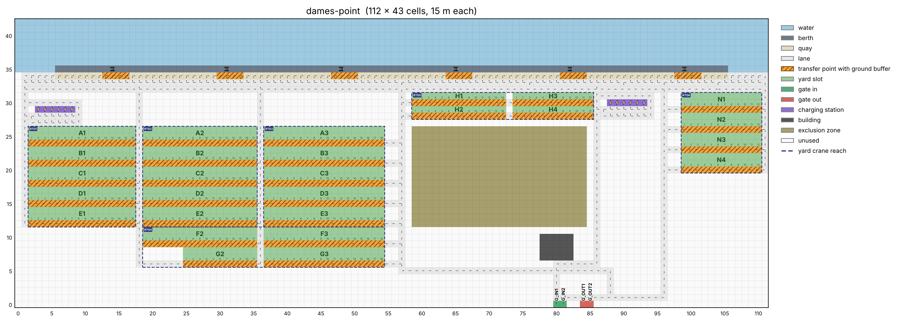

# terminal_layout

The terminal layout and topology module of the port simulator. It loads a terminal
description from a JSON file, checks it, and gives every other module one read-only
`Layout` object to ask questions of: what is at this cell, where can a truck go from
here, which cell serves this yard slot.

Python 3.11+. Depends on `pydantic`, `networkx` and `matplotlib` (plus `pytest` for tests).

## Setup

```bash
python -m venv .venv
source .venv/bin/activate          # Windows: .venv\Scripts\activate
pip install -e ".[dev]"
pytest                             # 227 tests, a few seconds
python examples/demo.py            # prints a tour and writes layout.png
```

## Using it

```python
from terminal_layout import load_layout, LayoutError

layout = load_layout("layouts/demo-12x8.json")     # raises LayoutError listing every problem

layout.cell(4, 1)                         # Cell(x, y, type, exits, attrs)
layout.neighbors(1, 1)                    # [(1, 0), (0, 1)]  one move away, ordered N, E, S, W
layout.shortest_path((10, 0), (1, 0))     # list of (x, y), or None
layout.transfer_point_for("A-03-02")      # the cell a crane works that slot from
layout.render_2d("layout.png")            # picture with arrows, ids, cranes, gates

closed = layout.with_closures({(5, 1)})   # a new Layout; `layout` is untouched
closed.warnings                           # rule 12: what the closure breaks
```

The `Layout` is immutable. Closures are a scenario you apply to a copy, never a change
to the map. Everything returned from it is a copy or read-only.

### API

| Call | Returns |
|---|---|
| `layout.name`, `.width`, `.height`, `.cell_size_m` | metadata |
| `cell(x, y)` | the `Cell`; `IndexError` off the grid |
| `cells(type=None)` | all cells, or one type, ordered by (x, y) |
| `is_traversable(x, y)` | True for an open lane, quay, transfer point, gate or charging-station cell |
| `exits(x, y)` | directions the static map allows, ordered N, E, S, W |
| `neighbors(x, y)` | cells one legal move away (closures applied), ordered N, E, S, W |
| `quay_cells(berth_id=None)` | quay strip cells, including transfer points under cranes |
| `gate_cells(flow=None)` | gate cells, or only `"in"` / `"out"` |
| `charging_stations()` | the charging-station cells; each has `attrs["id"]` |
| `transfer_points(block_id=None, berth_id=None)` | transfer-point cells |
| `transfer_point_for(slot_id)` | the transfer point serving that slot's bay |
| `slot(slot_id)`, `slots_in_block(block_id)` | slot cell; slot ids ordered by bay, then row |
| `blocks` | `{block_id: Block}` (a `Block` has `buffer_capacity`, `container_rows` and `capacity`) |
| `yard_cranes` | `{crane_id: YardCrane}`: the blocks each crane serves and its reach rectangle |
| `quay_cranes` | `{crane_id: QuayCrane}`: berth, `x`, every transfer lane under the crane, `buffer_capacity` |
| `berths` | `{berth_id: ((crane_id, (x, y)), ...)}`, the transfer point in each crane's own column |
| `with_closures(cells)` | new `Layout` with exactly those cells closed (replace, not add) |
| `closures`, `warnings` | current closed cells; rule 12 warnings for them |
| `shortest_path(a, b)` | fewest-move path, both ends included, or `None` |
| `validate()` | list of problems, empty when valid |
| `to_json(path=None)` | compiled dict for other modules; also written to `path` |
| `render_2d(path="layout.png", show_ids=False, ax=None)` | PNG, or draws onto your `ax` |

Cell types: `water`, `berth`, `quay`, `lane`, `transfer_point`, `yard_slot`, `gate`, `charging_station`, `blocked`.
Traversable ones: `quay`, `lane`, `transfer_point`, `gate`, `charging_station`.

### Coordinates

Integer `(x, y)`, x east, y north, origin at the bottom-left cell. One cell is
`cell_size_m` metres square (15 by default). A cell's `exits` are the directions a
vehicle may leave it in: any of `N`, `E`, `S`, `W`, always listed in that order.
A one-way road is a run of cells with a single exit each.

## Layout files

Two forms:

- **Authored** (`layouts/demo-12x8.json`): what a person writes and edits. Rectangles
  of water, lanes with exits, yard blocks with a size and origin, berths with cranes, gates,
  charging stations.
  (`layouts/dames-point.json` is authored too, but a script writes it; see below.)
- **Compiled** (`layouts/demo-12x8.compiled.json`): what `layout.to_json()` produces. A
  full grid plus every cell's attributes. Other modules read this; nobody edits it.
  It is regenerated, and a test fails if it is out of date:

  ```bash
  python -c "from terminal_layout import load_layout; load_layout('layouts/demo-12x8.json').to_json('layouts/demo-12x8.compiled.json')"
  ```

To add a terminal, copy `demo-12x8.json`, edit it, and run `load_layout` on it. Errors
come back as a list, every one tagged with a rule number, for example:

```
2 problems found:
  rule 4: lane cell (11, 5) exit N leads to (11, 6), which is not traversable (it is a berth cell)
  rule 8: block A bay 4 has no lane cell on service side S (expected at (5, 1))
```

Problems are reported in stages (file shape, then bounds/overlaps/ids, then the compiled
map), and a later stage waits until the earlier one is clean. Nothing is repaired silently.

## Dames Point

`layouts/dames-point.json` is the poster layout: JAXPORT's Dames Point container terminal in
Jacksonville, simplified to straight roads on a 15 m grid. It was traced by eye from satellite
imagery and written down as numbers in `tools/build_dames_point.py`.



| | |
|---|---|
| Grid | 112 x 43 cells (1,680 m by 645 m). The wharf runs along x with the river on top; column 0 is the south-east end of the site and row 0 the land side |
| Quay | 100 cells = 1,500 m of the real 1,525 m, split into `B1` (`QC1` to `QC3`) and `B2` (`QC4` to `QC6`) at x = 55/56 as a placeholder for the ship arrival owner. Cranes 17 cells (255 m) apart, each with four transfer lanes (x - 1 to x + 2) where a vehicle waits for the crane |
| Yard | 27 blocks, 419 bays, 786 ground slots of 3 container rows each, max tier 5 (11,790 containers): the south-east yard `A1` to `G3`, strip blocks `H1` to `H4` along the apron, the north-west yard `N1` to `N4` |
| Yard cranes | `RTG1` to `RTG3` take the three block columns of rows A to E, `RTG4` rows F and G, `RTG5` the strips, `RTG6` the north-west yard. Each has a reach rectangle (`layout.yard_cranes`), drawn as a dashed box |
| Charging | two depots of six stations, each with a passing lane, at sites chosen by a p-median solve: `CH1` to `CH6` at (3, 29) to (8, 29) beside the west column, `CH7` to `CH12` at (88, 30) to (93, 30) beside the inbound road |
| Transfer buffers | 2 containers at every transfer point (`buffer_capacity`), as in PortSim, the course's reference simulator; 0 is available for a coupled handover |
| Gates | in: `G_IN1` (80, 0), `G_IN2` (81, 0). out: `G_OUT1` (84, 0), `G_OUT2` (85, 0) |
| Not roads | the marsh and ponds in the middle (`blocked`, reason `exclusion`) and the gate buildings (reason `building`) |

`layouts/dames-point-trace.png` is the grid laid over the satellite photo, so anyone can see
where the cells came from. It carries the imagery credit (Airbus, Maxar Technologies, Google).

**How vehicles move.** Every road is one way, so the arrows in the picture are the whole
traffic plan. The quay lane and a bypass lane beside it both run east past all six cranes, and a
vehicle may change lane at any cell: it waits for a crane in one of the crane's four transfer
lanes while the traffic behind it passes on the bypass. From the bypass, forks drop south at
x = 57 (the east column, which feeds the service lane under each south-east block), at 76, 90
and 104 (onto the return lane, y = 32, which runs west to the east column so the east cranes
reach the yard without circling the site) and at 96 (the exit road). The service lanes of the
south-east yard flow west. Three roads carry traffic north out of the yard: the west column and
two aisles between block columns; they join the outbound road, the bypass and the quay. Trucks
come in at a gate-in lane, go north up the inbound road and turn west onto the return lane for
the yard, or carry on to the bypass for the north-west yard; they leave by the south road
(y = 5) from the foot of the east column to the gate-out lanes. Where two roads meet, the cell
has two exits.

Each charging depot is a loop of four rows beside a road: a passing lane and an access lane
side by side, the stations next to the access lane, and an exit lane back to the road. A vehicle
in the passing lane drives past one waiting in the access lane and turns in further along, so a
queue at the first station does not block the others. The depots sit beside the two northbound
roads that lead back to the quay: the west column (fork at (1, 28)) and the inbound road (fork at
(86, 29)). `tools/charger_siting.py` chose those sites by solving the p-median problem exactly over
every road cell with room for a depot; the built pair is within 8 moves of the optimum and cuts the
mean charging detour from 122 moves (the Oct 22 layout) to 69.5. Twelve stations is a placeholder
for the AGV owner to confirm.

One-way roads make trips long. The longest leg between a gate, a block and a crane is 211 moves
(3.2 km); a test fails if any leg goes over 250. Over the 6,704 gate, crane and bay trips the
median is 84 moves (v0.1: 86, longest 228).

**Changing it.** Edit the numbers in `tools/build_dames_point.py` and run it. It checks the
layout with `load_layout` first and writes nothing if a rule fails; otherwise it rewrites both
layout files and `docs/dames-point.png`. A test fails if the files in `layouts/` were edited by
hand or are out of date. A deliberate change also turns the pinned numbers in
`tests/test_dames_point.py` red (block, bay and slot counts, crane and gate positions); update
them in the same change.

```bash
python tools/build_dames_point.py
```

## Road graph and road variants

`python tools/export_graph.py` writes `layouts/dames-point.graph.json`: the map as a directed road graph,
the way PortSim describes a terminal. Nodes are stopping points (junctions, transfer points, chargers,
gates) with positions in metres; segments are the roads between them with `length_m` and the cells they
cross (750 stopping points, 1,028 segments, 20.3 km of road). The format is ours until we have PortSim's.

`python tools/build_road_variants.py` writes two variants to `layouts/variants/`, with every station kept:
`dames-point-two-way` (all roads two-way: median trip 52 moves, longest 119) and `dames-point-one-aisle`
(the x = 36 aisle removed: median 88, longest 245; the base map is 84 and 211). Closed roads need no
file: use `with_closures()`.

## Integration smoke test

`python examples/agv_stub.py` drives an AGV from QC1 to block A2 and back, and a truck from the gate
to block C3 and out, using only `neighbors()`, with each leg checked against `shortest_path`. It is a
stand-in for the AGV module: speed and handover times are named placeholders, and the router is one
function to replace.

## 3D viewer

`viewer3d/index.html` draws Dames Point in 3D with Three.js, from the compiled JSON only: stacked yard
slots, the six quay cranes and six RTGs, both charging depots, lane arrows, and a few demo vehicles.
Drag to orbit, scroll to zoom, click a cell to read it, and use the panel to fly to a crane or depot,
change the example yard fill, or toggle layers. `window.portViewer.cellCenter(x, y)` gives a cell's 3D
centre for anything drawn on top.

```bash
python -m http.server            # from the repo root, then open http://localhost:8000/viewer3d/
python tools/bundle_viewer.py    # or: one self-contained file, viewer3d/dames-point-3d.html
```

The demo vehicles follow `viewer3d/demo-routes.json`, written by `tools/build_viewer_routes.py` from
`Layout.shortest_path`; a test checks every step is a legal move. They are examples, not traffic: no
dispatch and no collisions. Re-run both tools after changing the map.

## Limits in v0.2

- Width and height are at most 500 cells each.
- A quay runs east-west only (a berth has one `quay_y` row; cranes sit at an `x` on it).
- One service-lane cell is the transfer point for one block bay, so two blocks cannot share
  one lane row. Give each block its own lane row (two adjacent rows is fine). The loader
  says so as a rule 8 conflict.
- `service_side` runs parallel to the bays: `N`/`S` for an `EW` block, `E`/`W` for an `NS` block.
- Unknown keys are errors. For remarks while tracing a real terminal, use `"notes": "..."`,
  which is allowed on the file and on every entry and is never read.
- `with_closures` replaces the closed set; it does not add to it.
- `buffer_capacity` is a whole number of at least 0 (0, the default, is a coupled handover: the crane
  lifts straight between the vehicle and the stack or ship). The layout stores it and never enforces
  it: it holds no containers.
- A quay crane's `transfer_lanes` (default 1) are quay cells of its berth centred on its `x`; an even
  count leans east. Two cranes' lanes may not overlap (rule 8).
- A charger goes on a plain lane cell, and with every charger occupied the road must still connect
  (rules 14 and 15). Put stations in a pocket or loop beside the road.

## Schema 1.1 and 1.2

Charging stations, `buffer_capacity` and yard crane reach arrived in schema 1.1; `transfer_lanes` on a quay
crane, and a `buffer_capacity` of 0 as the default, in 1.2. Authored files marked `"1.0"` or `"1.1"` still
load (a 1.1 file that left `buffer_capacity` out now compiles as 0 instead of 1). The compiled file always
says `"1.2"`: it has the `charging_station` cell type, `buffer_capacity` on transfer points, blocks and
berth cranes, `x` and `transfer_points` (one per lane) on each berth crane, and the top-level `chargers`
and `yard_cranes`. If you read the compiled JSON and keep your own list of drivable cell types, add
`charging_station`; if you assumed one transfer point per quay crane, read `transfer_points`; if you call
the Python API you need no change.

## The rules

| # | Checked | Where |
|---|---|---|
| 1 | Every rectangle, cell, crane and quay row is inside the grid, low corner first | authored |
| 2 | Nothing shares a cell (closures may sit on lanes) | authored |
| 3 | Ids are unique (including chargers); lanes only name berths that exist | authored |
| 4 | Every exit leads to a traversable cell inside the grid | map |
| 5 | No dead ends (a gate-out is allowed to have no exit) | map |
| 6 | The internal network is strongly connected | map |
| 7 | Gate-ins reach the network; every gate-out can be reached from it; every internal cell can reach a gate-out | map |
| 8 | Each bay has a lane cell on its service side; each crane has a quay cell under it | authored + map |
| 9 | Each transfer point touches the bay or berth it serves | map |
| 10 | Shapes and enums are right; unknown keys are errors (so `"exist"` is caught) | file |
| 11 | Closures name traversable cells only | `with_closures` |
| 12 | Warn if a closure breaks rule 6 or 7 (not an error: closing a road is allowed) | `with_closures` |
| 13 | Every block and berth has at least one transfer point | map |
| 14 | Each charger sits on a plain lane cell; no two share a cell | authored + map |
| 15 | With every charging station occupied, rules 6 and 7 still hold | map |

## Layout of the repo

```
terminal_layout/
  model.py      Cell, Block, YardCrane, LayoutError, directions, frozen data
  schema.py     pydantic models for the authored file (rule 10)
  authored.py   rules 1-3 and the block geometry
  loader.py     load_layout: stages, painting the grid, rules 8 and 14, yard cranes
  validate.py   rules 4-9, 11-13 and 15 on the compiled map
  graph.py      networkx graph, rules 6, 7, 12 and 15
  layout.py     the Layout class (the API above)
  export.py     compiled JSON and its on-disk formatting
  render.py     render_2d
layouts/        demo-12x8.json, dames-point.json, their compiled forms, dames-point-trace.png
tools/          build_dames_point.py (writes the Dames Point files), charger_siting.py (p-median depot siting),
                build_viewer_routes.py and bundle_viewer.py (the 3D viewer)
tests/          227 tests: every rule, the API, bad input, rendering, a 100 x 40 layout, Dames Point, schema 1.1 and 1.2
examples/       demo.py; agv_stub.py, one vehicle driving full jobs with neighbors() alone
docs/           layout-spec.md (the spec this was built from), demo-12x8.png, dames-point.png
```

## What the other modules should rely on

- Call `neighbors`, `is_traversable` and `shortest_path`; do not re-derive movement from `exits`.
- Read `to_json()` if you want plain data; read `Layout` if you want the API.
- Cell order, slot order and exit order are fixed, so runs with the same seed repeat.
- A yard transfer point is an ordinary lane cell on a one-way road (the service lane under each
  bay, which is the RTG's truck lane). A vehicle being served there stands in that lane and blocks
  the ones behind it, unless the traffic module treats service as a delay while it keeps moving.
  A route to a bay passes over the transfer points of the bays before it on the same lane. At the
  quay a waiting vehicle blocks only its own transfer lane; the rest pass on the bypass lane.
- The quay lane and the bypass lane are the one place a vehicle may move in both directions
  between two cells (a lane change at any x). Everywhere else is one way.
- A charging station is a lane cell with an `id`. `neighbors` and `is_traversable` treat it like any lane
  cell, so a vehicle can drive through it. Whether it may stop there, for how long and how fast it charges
  is for the AGV module.
- `buffer_capacity` on a transfer point is a number the layout stores and never enforces. 0 means the vehicle
  waits for the crane and nothing is set on the ground; above 0, what happens when the buffer is full belongs
  to the modules that move containers.
- Do not mutate anything you get back. You can't: it is frozen.
