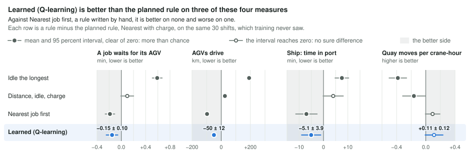
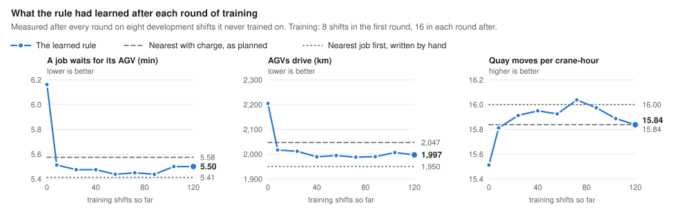

# A dispatch rule learned in the simulator

Written by `python tools/learned_dispatch.py report` from `sim/dispatch_weights.json` and `docs/learned-dispatch-training.json` (`python tools/learned_dispatch.py train` writes both) and `docs/learned-dispatch.json` (`python tools/learned_dispatch.py test` writes it). The rule is `sim/dispatch_learned.py`; how it is trained is at the top of `tools/learned_dispatch.py`.

A learned dispatch rule is the AGV owner's idea (the check-in of Oct 22: Q-learning). This is one way to build it, made in the integration so that the idea can be tried in the whole terminal. It is the owner's to adopt, change or replace. Nothing else depends on it: the terminal still runs Nearest with charge as planned, and the experiment in `docs/experiments.md` is as it was.

## In short

* **What it is.** Whenever an AGV is free and jobs are waiting, the rule scores every pair of a waiting job and a free AGV and starts the pair with the lowest score. A score is a sum of 13 weights. The weights were learned by Q-learning inside the simulator, from 120 shifts and 100,578 choices, 30,745 of them made by lot.
* **The test.** 30 shifts that training never saw, the same 30 the experiment uses, each rule on the same shifts. Against Nearest with charge, the rule the terminal runs as planned: Better, and more than chance: a job waits 0.15 ± 0.10 min less for its AGV (3%); the AGVs drive 50 ± 12 km less over a shift (2%); the quay cranes wait 28 ± 12 min less for AGVs over a shift (10%); a ship is in port 5.1 ± 3.9 min less (1%). No sure difference: quay moves per crane-hour (+0.11 ± 0.12); a truck's time gate to gate (+0.06 ± 0.25 min); the longest wait of any job (-0.4 ± 2.5 min).
* **Against a rule written by hand with the same freedom** (Nearest job first: the pair with the shortest drive): Worse, and more than chance: the AGVs drive 47 ± 10 km more over a shift (2%); the quay cranes wait 18 ± 9 min longer for AGVs over a shift (8%). No sure difference: the wait of a job for its AGV (+0.03 ± 0.08 min); quay moves per crane-hour (+0.02 ± 0.11); a ship's time in port (+1.9 ± 3.4 min); a truck's time gate to gate (+0.15 ± 0.26 min); the longest wait of any job (+0.9 ± 2.9 min).
* **What that says.** Learning did not beat a rule one line long. Starting from nothing, the rule learned that the drive is what matters (the learning curve below). Nearest job first, which was told that and nothing else, still does as well or better on every measure.
* **How much there is to win.** Between a rule that ignores distance (the job that has waited longest, the lowest-numbered AGV) and Nearest job first lie 12% of the wait of a job, 12% of the kilometres, 4% of a ship's time in port and 3% of the quay moves per crane-hour (the eight development shifts). That is the whole gap between ignoring distance and the best rule here, and Nearest with charge, the planned rule, already has 78% of the first and 62% of the second.
* **Checks.** 420 of 420 test runs finished and none failed a check. The rules written before gave the experiment's published numbers again (690 of 690 the same).

## The question the rule answers

The three rules the terminal had (Nearest with charge, Idle the longest, Distance, idle, charge) are asked: this job has waited longest, which AGV gets it? The two rules added here are asked a wider question: of every waiting job and every free AGV that could take it, which pair starts now?

| Rule | In the code | What it starts |
| --- | --- | --- |
| Nearest job first | `nearest_job` | The pair with the shortest drive to the pickup. Written by hand, one line. It is the yardstick: it has the learned rule's freedom and no learning, so what separates the two is what learning added. |
| Learned (Q-learning) | `learned` | The pair with the lowest score, the score being a sum of weights that were learned. |

Two things hold under both, as they do under every rule. A job for a truck goes before a job for a ship: that is the scheduler's priority. And a job that has waited ten minutes is taken before any other. Ten minutes is the wait the simulator already reports as a stall.

The second is there because a rule that looks only at the drive leaves far jobs waiting. On the eight development shifts the longest wait of any job averaged 71 min under Nearest job first without it and 32 min with it (28 min under Nearest with charge).

How much room is there to choose? In the training shifts the fleet started 100,578 jobs. In 87% of those moments there was more than one pair on offer, and in 27% more than one job: only there can the two new rules differ from the old question.

## The test

Seeds 1 to 30 of `sim.scenario.shift`: the experiment's own shifts (four ships with 140 to 240 moves each, 80 trucks, 30 AGVs, the calibrated numbers of `docs/data-sheet.md`). Training used other seeds and so did every decision made while building this. A cell is the mean of 30 runs plus or minus half the width of its 95 percent confidence interval. Under the rules, two rules are compared run by run on the same shifts; a difference marked **\*** has an interval that does not include zero: it is more than chance. There are many comparisons on this page: if no two rules differed at all, about one in twenty would still be marked.

| Rule | A job waits for its AGV (min) | Quay moves per crane-hour | Ship: time in port (min) | Truck: gate to gate (min) | Quay cranes wait (min) | AGVs drive (km) |
| --- | ---: | ---: | ---: | ---: | ---: | ---: |
| Nearest with charge | 5.71 ± 0.20 | 15.71 ± 0.28 | 442.3 ± 26.8 | 13.37 ± 0.55 | 283 ± 33 | 2033 ± 34 |
| Idle the longest | 6.30 ± 0.19 | 15.33 ± 0.26 | 449.9 ± 26.9 | 13.53 ± 0.64 | 303 ± 34 | 2224 ± 34 |
| Distance, idle, charge | 5.80 ± 0.18 | 15.55 ± 0.28 | 446.3 ± 27.0 | 13.58 ± 0.67 | 283 ± 31 | 2058 ± 35 |
| Nearest job first | 5.52 ± 0.16 | 15.81 ± 0.24 | 435.3 ± 28.2 | 13.28 ± 0.59 | 237 ± 24 | 1936 ± 28 |
| Learned (Q-learning) | 5.55 ± 0.17 | 15.83 ± 0.25 | 437.2 ± 27.7 | 13.43 ± 0.60 | 255 ± 29 | 1983 ± 31 |
| *Learned (Q-learning) minus Nearest with charge* | -0.15 ± 0.10 **\*** | +0.11 ± 0.12 | -5.1 ± 3.9 **\*** | +0.06 ± 0.25 | -28 ± 12 **\*** | -50 ± 12 **\*** |
| *Learned (Q-learning) minus Nearest job first* | +0.03 ± 0.08 | +0.02 ± 0.11 | +1.9 ± 3.4 | +0.15 ± 0.26 | +18 ± 9 **\*** | +47 ± 10 **\*** |
| *Nearest job first minus Nearest with charge* | -0.19 ± 0.08 **\*** | +0.09 ± 0.10 | -7.0 ± 4.4 **\*** | -0.09 ± 0.23 | -46 ± 13 **\*** | -97 ± 17 **\*** |

| Rule | Longest wait of a job (min) | Training cost (min) |
| --- | ---: | ---: |
| Nearest with charge | 35.7 ± 2.9 | 4806 ± 203 |
| Idle the longest | 34.9 ± 3.2 | 5307 ± 201 |
| Distance, idle, charge | 34.0 ± 3.8 | 4888 ± 185 |
| Nearest job first | 34.4 ± 2.6 | 4651 ± 174 |
| Learned (Q-learning) | 35.3 ± 2.9 | 4685 ± 175 |
| *Learned (Q-learning) minus Nearest with charge* | -0.4 ± 2.5 | -122 ± 76 **\*** |
| *Learned (Q-learning) minus Nearest job first* | +0.9 ± 2.9 | +33 ± 64 |
| *Nearest job first minus Nearest with charge* | -1.2 ± 2.3 | -155 ± 60 **\*** |

The training cost is what the rule learned to keep low: the minutes jobs wait for an AGV, summed over the shift.



Nearest job first against Nearest with charge, which shows what the freedom to choose the job is worth without any learning: Better, and more than chance: a job waits 0.19 ± 0.08 min less for its AGV (3%); the AGVs drive 97 ± 17 km less over a shift (5%); the quay cranes wait 46 ± 13 min less for AGVs over a shift (16%); a ship is in port 7.0 ± 4.4 min less (2%). No sure difference: quay moves per crane-hour (+0.09 ± 0.10); a truck's time gate to gate (-0.09 ± 0.23 min); the longest wait of any job (-1.2 ± 2.3 min).

## How it was learned

1. The simulator runs a shift. Every 10 seconds of terminal time the cost is read. The cost is the minutes jobs wait for an AGV: at every reading, one for each job with no AGV at its pickup yet. The reading changes nothing: a run with it is the same run as without (a test holds this).
2. Each time the fleet starts a job the choice is noted: the situation, the pairs on offer, the pair chosen.
3. After the shift each choice gets a target, the cost that followed it: the cost of the next 15 minutes as it happened, each minute counting less than the one before (half as much after 5 minutes), plus the rule's own estimate of what comes after, for the best choice open at the next decision past those 15 minutes. With these numbers about 88% of a target is cost that was seen.
4. In the first round every choice is made by lot, so the rule starts knowing nothing. In the later rounds it follows the weights fitted so far, except for a share of choices still made by lot (50%, 40%, 30%, 30%, 20%, 20%, 20%). After each round the weights are fitted again, by least squares, to every choice made by lot so far.

Why the choices made by lot, and only those. Most of the cost that follows a choice has nothing to do with the choice: it is how busy the terminal is at that moment. Where the rule chose, what it chose depends on the situation, and a plain fit credits the choice with the situation. Where the lot chose, the chosen pair differs from the average pair on offer by chance alone. So the fit explains each target by the situation (six numbers: jobs waiting, AGVs on their way, AGVs free, the cost being paid, cranes at work, and a constant), by the average pair on offer, and by the pair chosen; the weights of the pair chosen are the rule. It is an experiment run inside the simulator. What the plain fit learns from the same shifts is under "What was tried and not kept".

Training took 8 rounds and 120 shifts (seeds 1001 to 1120). The final fit explains 90% of the spread of the targets, nearly all of it by the situation. The pair chosen moves the cost that follows by a minute or two at most, and what nothing explains is several times larger: that is why it takes so many choices to settle a weight.

In the terms of reinforcement learning:

| Term | Here |
| --- | --- |
| State | The terminal at a moment when a job can start, seen through the situation numbers and the pairs on offer |
| Action | One pair of a waiting job and a free AGV. The set of actions is different at every decision, which is why the rule scores pairs and keeps no table |
| Reward | Minus the cost: the minutes jobs wait for an AGV (at every reading, one for each job with no AGV at its pickup yet) |
| Discount | Continuous in time: a half every 5 minutes. Decisions are not evenly spaced, so the discount goes by the clock, not by the step |
| Q-function | Linear: the level of the situation (the six numbers and the average pair) plus the weights times the features of the pair. The level is the same for every pair on offer, so the choice needs only the weights |
| Target | n-step: the discounted cost seen until the first decision at least 15 minutes later, plus the discounted Q of the best action there, computed with the weights that ran the episode (in the first round there are none yet, and that part is zero). Not corrected for the choices by lot inside those minutes |
| Exploring | Epsilon-greedy over the pairs on offer, epsilon 1, 0.5, 0.4, 0.3, 0.3, 0.2, 0.2, 0.2 by round |
| Update | Batch (fitted Q iteration): after each round, least squares on every exploratory choice so far, with a small ridge term (0.0001) |

## The learning curve

After each round the rule as it then stood, with no choices by lot, ran eight development shifts (seeds 5001 to 5008). They are not training shifts and not test shifts; every decision about the method was made on them.



| After | Training shifts | Choices by lot so far | A job waits for its AGV (min) | Quay moves per crane-hour | Ship: time in port (min) | AGVs drive (km) | Training cost (min) |
| --- | ---: | ---: | ---: | ---: | ---: | ---: | ---: |
| no training | 0 | 0 | 6.16 | 15.51 | 457.1 | 2205 | 5250 |
| round 1 | 8 | 6,094 | 5.51 | 15.81 | 448.6 | 2017 | 4692 |
| round 2 | 24 | 12,033 | 5.47 | 15.91 | 445.6 | 2012 | 4672 |
| round 3 | 40 | 16,690 | 5.47 | 15.95 | 444.7 | 1989 | 4655 |
| round 4 | 56 | 20,217 | 5.44 | 15.93 | 444.1 | 1994 | 4628 |
| round 5 | 72 | 23,798 | 5.45 | 16.04 | 441.1 | 1988 | 4644 |
| round 6 | 88 | 26,171 | 5.44 | 15.97 | 444.6 | 1990 | 4617 |
| round 7 | 104 | 28,520 | 5.50 | 15.89 | 445.8 | 2007 | 4672 |
| round 8 | 120 | 30,745 | 5.50 | 15.84 | 445.6 | 1997 | 4667 |
| *Nearest with charge* |  |  | 5.58 | 15.84 | 450.1 | 2047 | 4743 |
| *Nearest job first* |  |  | 5.41 | 16.00 | 439.8 | 1950 | 4612 |

Before any training every score is zero and the rule takes the job that has waited longest and the lowest-numbered AGV. Eight shifts are few, so the rule after the last round is compared shift by shift with:

* **No training.** Better, and more than chance: a job waits 0.66 ± 0.15 min less for its AGV (11%); the AGVs drive 207 ± 27 km less over a shift (9%); each quay crane makes 0.33 ± 0.23 more moves an hour (2%); a ship is in port 11.4 ± 8.9 min less (3%). No sure difference: the longest wait of any job (+3.3 ± 7.8 min).
* **Nearest with charge.** Better, and more than chance: the AGVs drive 50 ± 23 km less over a shift (2%). Worse, and more than chance: the longest wait of any job is 4.7 ± 4.0 min longer (17%). No sure difference: the wait of a job for its AGV (-0.07 ± 0.13 min); quay moves per crane-hour (0.00 ± 0.19); a ship's time in port (-4.5 ± 8.7 min).
* **Nearest job first.** Worse, and more than chance: the AGVs drive 47 ± 25 km more over a shift (2%). No sure difference: the wait of a job for its AGV (+0.09 ± 0.18 min); quay moves per crane-hour (-0.16 ± 0.28); a ship's time in port (+5.8 ± 6.8 min); the longest wait of any job (+0.8 ± 7.4 min).

The test above, on other shifts and more of them, is the measurement.

Of the 104 development runs behind this section, 104 finished and none failed a check.

## What it learned

A weight says how much the cost that follows a choice changes, in minutes, with one thing about the pair, the rest equal. Lower is better, so a positive weight counts against a pair. The standard error says how far the weight moves when one training shift is left out (a jackknife over shifts); a weight less than two standard errors from zero is not settled, and is marked.

| What the rule looks at | Unit | Weight (min) | Standard error | |
| --- | --- | ---: | ---: | --- |
| The drive from the AGV to the pickup, for a job at a quay crane that no AGV is coming to yet | per 100 m | +0.16 | 0.06 |  |
| The same drive, when one AGV is already coming to that crane: added to the line above | per 100 m | -0.12 | 0.06 |  |
| The same drive, when two or more are: added to the first line | per 100 m | -0.10 | 0.06 | not settled |
| The same drive, when the job fetches an export for a ship: added to the first line | per 100 m | -0.05 | 0.06 | not settled |
| The same drive, when the job is for a truck: added to the first line | per 100 m | -0.02 | 0.08 | not settled |
| How long the job has waited for an AGV | per minute waited | +0.21 | 0.10 |  |
| The part of that wait beyond four minutes: added to the line above | per minute beyond four | -0.26 | 0.18 | not settled |
| The job is at a quay crane that one AGV is already coming to | yes or no | +1.37 | 0.98 | not settled |
| The job is at a quay crane that two or more AGVs are already coming to | yes or no | +0.76 | 0.95 | not settled |
| The job fetches an export for a quay crane that no AGV is fetching for yet | yes or no | +1.96 | 1.35 | not settled |
| The job fetches an export for a quay crane that one AGV is already fetching for | yes or no | -2.00 | 1.34 | not settled |
| The job fetches an export for a quay crane that two or more are already fetching for | yes or no | -0.38 | 1.09 | not settled |
| The job takes an import to a truck, against fetching a truck's export | yes or no | +3.35 | 1.98 | not settled |

Put together, what each 100 m of drive to the pickup adds to a pair's score:

| The job is | Each 100 m adds (min) | Standard error |
| --- | ---: | ---: |
| at a quay crane that no AGV is coming to yet | +0.16 | 0.06 |
| at a quay crane that one AGV is coming to | +0.04 | 0.04 |
| at a quay crane that two or more are coming to | +0.06 | 0.02 |
| fetching an export for a ship | +0.11 | 0.03 |
| for a truck | +0.15 | 0.06 |

And what the wait so far adds:

| The job has waited | 2 min | 4 min | 6 min | 8 min |
| --- | ---: | ---: | ---: | ---: |
| Added to the score (min) | +0.42 | +0.84 | +0.74 | +0.64 |
| Standard error | 0.19 | 0.38 | 0.37 | 0.49 |

The lines for the kind of job (the last six in the first table) are each measured against a job at a quay crane that no AGV is coming to yet, except the last, which compares the two kinds of job for a truck with each other: a truck's job is never on offer together with a ship's.

Settled, of the 13: `drive`, `drive_served_1`, `waited`. The others the rule cannot tell from zero with this much training, yet they still steer its choices, and a weight that is only noise costs something each time it decides. The standard errors fall with the square root of the number of training shifts: four times the shifts would halve them.

## What it was not trained on

The rule learned with 30 AGVs on shifts at real scale. The same 30 seeds with a smaller and a larger fleet, and the experiment's small workloads (three ships with about ten containers each, 14 trucks, 10 AGVs, on the reference numbers, where every time is fixed), show how far it carries.

### 18 AGVs

90 runs, 90 finished, 0 failed checks.

| Rule | A job waits for its AGV (min) | AGVs drive (km) | Quay cranes wait (min) | Ship: time in port (min) | Truck: gate to gate (min) | Longest wait of a job (min) |
| --- | ---: | ---: | ---: | ---: | ---: | ---: |
| Nearest with charge | 8.14 ± 0.31 | 2109 ± 38 | 657 ± 67 | 511.9 ± 22.8 | 12.97 ± 0.60 | 30.2 ± 2.5 |
| Nearest job first | 7.62 ± 0.28 | 1940 ± 29 | 553 ± 59 | 493.2 ± 24.3 | 12.94 ± 0.60 | 30.9 ± 2.2 |
| Learned (Q-learning) | 7.77 ± 0.27 | 2028 ± 32 | 612 ± 57 | 497.7 ± 23.8 | 12.85 ± 0.52 | 31.0 ± 1.8 |
| *Learned (Q-learning) minus Nearest with charge* | -0.37 ± 0.09 **\*** | -81 ± 12 **\*** | -45 ± 16 **\*** | -14.2 ± 4.1 **\*** | -0.12 ± 0.21 | +0.8 ± 1.5 |
| *Learned (Q-learning) minus Nearest job first* | +0.15 ± 0.07 **\*** | +88 ± 8 **\*** | +59 ± 12 **\*** | +4.5 ± 2.6 **\*** | -0.09 ± 0.20 | +0.1 ± 1.8 |
| *Nearest job first minus Nearest with charge* | -0.52 ± 0.10 **\*** | -169 ± 15 **\*** | -103 ± 19 **\*** | -18.8 ± 4.1 **\*** | -0.03 ± 0.24 | +0.8 ± 1.6 |

### 36 AGVs

90 runs, 90 finished, 0 failed checks.

| Rule | A job waits for its AGV (min) | AGVs drive (km) | Quay cranes wait (min) | Ship: time in port (min) | Truck: gate to gate (min) | Longest wait of a job (min) |
| --- | ---: | ---: | ---: | ---: | ---: | ---: |
| Nearest with charge | 5.27 ± 0.18 | 1998 ± 34 | 215 ± 29 | 434.5 ± 27.9 | 13.61 ± 0.67 | 35.5 ± 2.9 |
| Nearest job first | 5.16 ± 0.17 | 1937 ± 31 | 196 ± 25 | 428.4 ± 28.6 | 13.67 ± 0.75 | 37.1 ± 2.7 |
| Learned (Q-learning) | 5.16 ± 0.17 | 1963 ± 31 | 208 ± 27 | 430.8 ± 28.3 | 13.53 ± 0.65 | 35.1 ± 2.6 |
| *Learned (Q-learning) minus Nearest with charge* | -0.12 ± 0.06 **\*** | -35 ± 9 **\*** | -6 ± 10 | -3.6 ± 2.8 **\*** | -0.09 ± 0.26 | -0.5 ± 2.2 |
| *Learned (Q-learning) minus Nearest job first* | 0.00 ± 0.06 | +26 ± 9 **\*** | +13 ± 10 **\*** | +2.5 ± 3.1 | -0.14 ± 0.25 | -2.0 ± 2.9 |
| *Nearest job first minus Nearest with charge* | -0.12 ± 0.07 **\*** | -61 ± 13 **\*** | -19 ± 12 **\*** | -6.1 ± 3.6 **\*** | +0.06 ± 0.29 | +1.6 ± 2.9 |

### The small workloads

90 runs, 90 finished, 0 failed checks.

| Rule | A job waits for its AGV (min) | AGVs drive (km) | Quay cranes wait (min) | Ship: time in port (min) | Truck: gate to gate (min) | Longest wait of a job (min) |
| --- | ---: | ---: | ---: | ---: | ---: | ---: |
| Nearest with charge | 17.45 ± 1.21 | 171 ± 6 | 57 ± 14 | 72.0 ± 5.3 | 27.67 ± 3.02 | 64.1 ± 5.7 |
| Nearest job first | 17.19 ± 1.20 | 169 ± 6 | 58 ± 14 | 70.5 ± 5.2 | 27.50 ± 3.27 | 63.2 ± 5.1 |
| Learned (Q-learning) | 17.25 ± 1.23 | 170 ± 6 | 54 ± 14 | 70.6 ± 5.6 | 28.08 ± 3.35 | 62.9 ± 5.4 |
| *Learned (Q-learning) minus Nearest with charge* | -0.20 ± 0.31 | -1 ± 1 | -2 ± 6 | -1.4 ± 1.8 | +0.42 ± 1.37 | -1.2 ± 2.5 |
| *Learned (Q-learning) minus Nearest job first* | +0.07 ± 0.27 | +1 ± 1 | -3 ± 6 | +0.2 ± 1.6 | +0.58 ± 1.15 | -0.4 ± 2.3 |
| *Nearest job first minus Nearest with charge* | -0.26 ± 0.30 | -2 ± 2 | +1 ± 5 | -1.5 ± 2.2 | -0.17 ± 1.38 | -0.8 ± 2.3 |

### The plan's own morning

One morning, with no seed and no randomness (`sim.scenario.demo`): three ships, 58 containers, 12 AGVs on the reference numbers. It is the run the 3D view opens on, so this is what a visitor sees when the rule is switched in the control room. One run is an example, not a measurement.

| Rule | Finished after (min) | A job waits for its AGV (min) | AGVs drive (km) | Ship: time in port (min) | Truck: gate to gate (min) |
| --- | ---: | ---: | ---: | ---: | ---: |
| Nearest with charge | 115.1 | 12.90 | 156.2 | 69.3 | 14.70 |
| Nearest job first | 114.3 | 12.10 | 148.2 | 62.9 | 14.10 |
| Learned (Q-learning) | 121.5 | 13.10 | 155.7 | 64.9 | 15.90 |

## What was tried and not kept

**The plain fit.** The usual way to fit a Q-function uses every choice, the rule's own as well as those by lot, and no average pair. On the same training shifts (100,578 choices) it gives a rule that does this on the development shifts, from the weights under it:

| On the development shifts | A job waits for its AGV (min) | Quay moves per crane-hour | Ship: time in port (min) | AGVs drive (km) | Longest wait of a job (min) |
| --- | ---: | ---: | ---: | ---: | ---: |
| The rule as trained (choices by lot, against the average pair) | 5.50 | 15.84 | 445.6 | 1997 | 32.6 |
| The plain fit | 5.53 | 15.88 | 447.0 | 2029 | 31.3 |

| What the rule looks at | Weight as trained | Weight from the plain fit |
| --- | ---: | ---: |
| `drive` | +2.47 | +2.51 |
| `drive_served_1` | -1.81 | -2.61 |
| `drive_served_2` | -1.50 | +0.39 |
| `drive_load` | -0.82 | -0.02 |
| `drive_truck` | -0.29 | -1.28 |
| `waited` | +2.10 | +14.32 |
| `waited_long` | -2.61 | -20.02 |
| `discharge_1` | +1.37 | +3.01 |
| `discharge_2` | +0.76 | -0.87 |
| `load_0` | +1.96 | -3.82 |
| `load_1` | -2.00 | -6.92 |
| `load_2` | -0.38 | -7.66 |
| `deliver` | +3.35 | -0.95 |

(These are in the features' own units: the drive in hundreds of moves of 15 m, the wait in tens of minutes.) Shift by shift on the development shifts, the rule as trained against the plain fit: Better, and more than chance: the AGVs drive 31 ± 20 km less over a shift (2%). No sure difference: the wait of a job for its AGV (-0.03 ± 0.15 min); quay moves per crane-hour (-0.04 ± 0.26); a ship's time in port (-1.4 ± 7.2 min); the longest wait of any job (+1.2 ± 10.3 min).

The first version of the training used the plain fit. Its curve stopped improving after the first round, and its weights for the kind of job changed sign with the cost being trained on, a sign that they were measuring the situation and not the choice. That is why the fit was changed. The runs of that first version were stopped after four rounds and are not kept; the plain fit above, on the final shifts, stands in for them.

**Another cost.** The rule can be trained to keep something else low. Tried: what a late AGV holds up (at every reading, one for each quay crane with a container to hand over and no AGV there, one for each export or truck job with no AGV at its pickup yet, and 0.2 for each AGV driving to a pickup). `python tools/learned_dispatch.py train --cost blocked` trains it and writes `docs/learned-dispatch-training-blocked.json`. Same method, same shifts. On the development shifts after the last round:

| Trained to keep low | A job waits for its AGV (min) | Quay moves per crane-hour | Ship: time in port (min) | AGVs drive (km) | Longest wait of a job (min) |
| --- | ---: | ---: | ---: | ---: | ---: |
| The minutes jobs wait for an AGV (kept) | 5.50 | 15.84 | 445.6 | 1997 | 32.6 |
| What a late AGV holds up | 5.46 | 16.01 | 443.5 | 2020 | 30.8 |

Shift by shift, the second against the first: Worse, and more than chance: the AGVs drive 23 ± 12 km more over a shift (1%). No sure difference: the wait of a job for its AGV (-0.04 ± 0.15 min); quay moves per crane-hour (+0.17 ± 0.24); a ship's time in port (-2.1 ± 7.1 min); the longest wait of any job (-1.8 ± 8.0 min). The first was kept. The rule set beforehand was to keep the plainer cost unless the other was clearly better on both quay moves and ship time: the plainer cost needs no assumption (the other has to say how a minute of empty driving compares with a minute of a blocked crane), and the wait of a job is what the experiment already reports for dispatch.

**A table.** Q-learning is usually first met with a table of states and actions. Here the actions are whichever jobs and AGVs happen to be free, a different list at every decision, so there is no fixed table to fill; the rule scores each pair with the same weights instead.

## Limits

* The rule is a weighted sum of 13 things chosen by hand. Learning sets how much each counts; it cannot find a new thing to look at.
* It learned on one kind of shift: `sim.scenario.shift` with 30 AGVs and 10 trucks an hour. Other fleets and the small workloads are above; another map, other crane rates or a heavier truck load were not tried.
* It was trained to keep one thing low: the minutes jobs wait for an AGV. What it does to ship time, quay rate, kilometres and energy is measured, not aimed at.
* Each target follows the cost for 15 minutes under the choices actually made, some of them by lot, before the rule's own estimate takes over. So the weights are for a terminal that still makes some choices by lot. All rounds are fitted together, so the first round, where every choice was by lot, still counts.
* The standard errors treat the training shifts as independent. Shifts of a later round follow weights fitted on earlier rounds, so they are not quite.
* The rule knows about charge only what every rule knows: whether the AGV has enough for the job. It does not plan charging.
* Before the seeds were set aside, three rules written by hand were each run once on seeds 1 to 3 to see how much dispatch can change. Nothing was tuned on those runs, and the learned rule saw none of the test seeds before the test.
* The numbers are a model's: they rank the rules on this map, they are not a forecast for a real terminal.

## If the owner takes it further

* **Train longer.** `python tools/learned_dispatch.py train --rounds 32` trains from the start with that many rounds: the first 8 as here, the rest like the last. More shifts settle more weights: the standard errors fall with the square root of the number of shifts.
* **Pull unsure weights toward zero.** A weight could be shrunk by as much as it is unsure before the rule uses it (a ridge fit, or dropping what is not settled). Not tried here, so that the method stayed one thing decided before the test.
* **Give it more to look at.** The charge of the AGV, whether the crane's buffer is full, where the job ends and what is likely to be waiting near there. Each is one more number in `features()` in `sim/dispatch_learned.py` and one more weight.
* **Aim it at something else.** The cost is one function, `cost_rate()` in `tools/learned_dispatch.py`. Ship time or kilometres could be put in it directly.
* **A network in place of the weights.** It could find what a weighted sum cannot. It would need many times the shifts, and the small gap between a rule that knows nothing and the best rule here says there is not much to find on this map.

## Run it yourself

```
python tools/learned_dispatch.py train     # 120 training shifts and the development runs: 33 min with 1 at a time where this was made
python tools/learned_dispatch.py test      # 423 runs: 29 min with 2 at a time
python tools/learned_dispatch.py report    # this page and its two figures
python sim/run.py --dispatch learned       # the plan's morning under the learned rule
```

Training and the test are the same from run to run: training twice gives the same weights to the last digit. In the control room (`python tools/control_room.py`) the rule is "Learned (Q-learning)" under AGV jobs; click an AGV to read why it was sent where it was.
